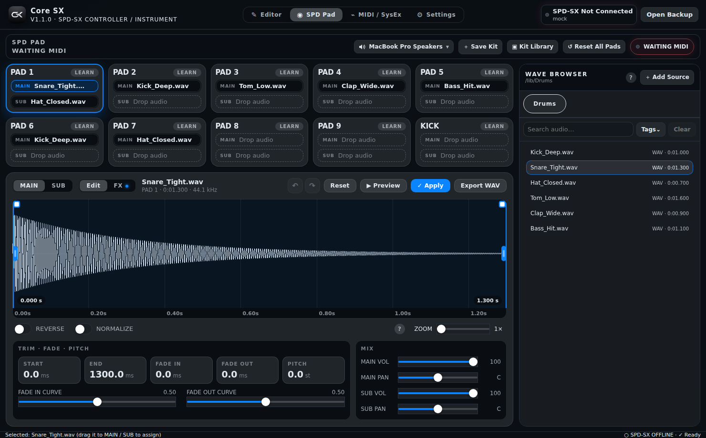
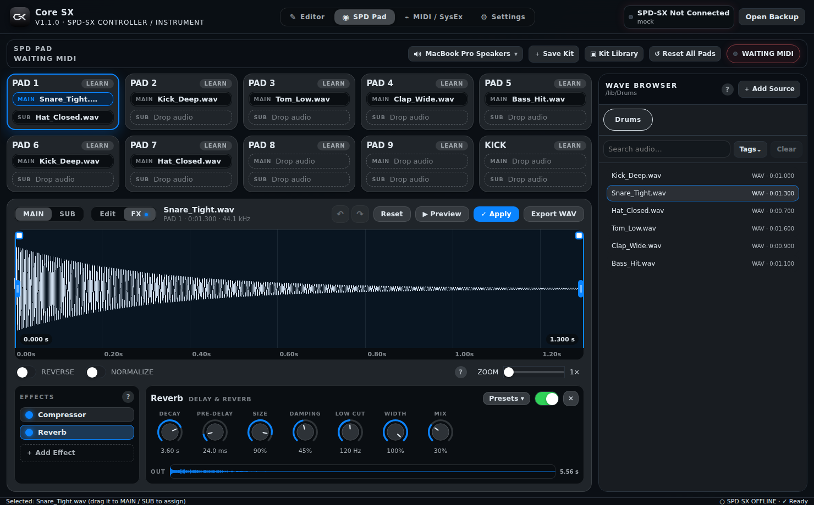
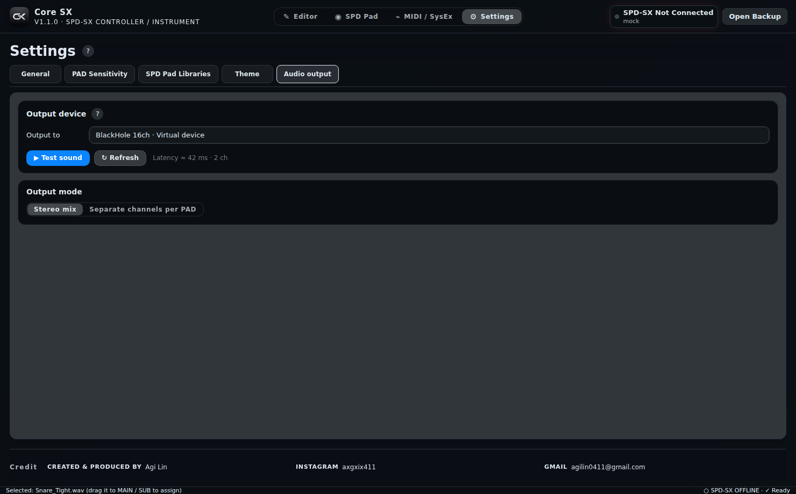

<p align="center"></p>

<h1 align="center">Core SX</h1>

<p align="center">為 Roland SPD-SX / SPD-SX Special Edition 重新設計的編輯器、MIDI 控制器與電腦端樂器。</p>

<p align="center"><a href="README.md">English</a> · <a href="docs/PUBLISHING.md">發佈教學</a></p>

<p align="center"></p>

## 功能

- **兩種模式，自動偵測**：*Editor*（SPD-SX 在 WAVE MGR 模式時，瀏覽並編輯機器內的 Kit 與 Wave）與 *Instrument*（由電腦發聲，SPD-SX 只負責當 AUDIO/MIDI 控制器）。
- **10 個 PAD × MAIN / SUB 兩層**：從音源庫拖曳到目標層，或在音源上按右鍵 → MAIN / SUB → PAD。*Learn* 可抓取實體 PAD 的輸入訊號。
- **Wave Editor**：Start / End、可拖曳曲線的淡入淡出（Logic Pro 風格）、Reverse、Normalize、Pitch、音量與聲像、復原／重做、匯出 WAV。
- **每一層都能掛效果器**：Noise Gate、Compressor、Channel EQ、Filter、Overdrive、Distortion、Chorus、Flanger、Delay、Reverb，採 Logic 風格的插件欄位並附預設。效果會預先烘焙，發聲延遲與沒有效果器時相同。
- **可由 DAW 演奏**：Core SX 會建立名為「Core SX」的虛擬 MIDI 連接埠，Logic Pro（或任何 DAW）可以把 PAD 當作 External Instrument 彈奏，有沒有接 SPD-SX 都可以。
- **音訊輸出**：可選任何系統輸出裝置（包含 BlackHole、Loopback 這類虛擬裝置，用來送進 Logic Pro），可以同時再送到第二個「監聽」裝置，多聲道裝置還能讓每個 PAD 走獨立聲道。
- **Kit 資料庫**：Instrument 模式存在電腦端，Editor 模式存在機器端。
- **MIDI / SysEx 工具**、四種介面語言（繁體中文、English、日本語、한국어）、主題配色、文字大小、系統音效風格、PAD 靈敏度。

<p align="center"> </p>

## 開始使用

需求：macOS、**Node.js 20 以上**、Xcode 命令列工具（`xcode-select --install`）。MIDI 模組是原生外掛，會在 `npm install` 時編譯。

```bash
git clone https://github.com/<your-account>/core-sx.git
cd core-sx
npm install
npm run dev
```

打包安裝檔（Apple Silicon、未簽署）：

```bash
npm run dist:mac:arm64:unsigned     # → release/*.dmg 與 *.zip
```

簽署與公證請看 [RELEASE.md](RELEASE.md)；未簽署版請看 [RELEASE_UNSIGNED.md](RELEASE_UNSIGNED.md)。

## 把聲音送進 Logic Pro（或其他 App）

Core SX 本身無法變成一個音訊裝置，需要借助虛擬裝置：

1. 安裝虛擬音訊驅動，例如免費的 [BlackHole](https://existential.audio/blackhole/) 或 Loopback。
2. 在 Core SX：**設定 → 音訊輸出**，選這個裝置。
3. 在 Logic Pro：**設定 → 音訊**，輸入裝置選同一個，音軌的輸入來源選對應聲道。
4. 想一邊錄一邊聽，請在 macOS 的「音訊 MIDI 設定」建立「多重輸出裝置」或「聚集裝置」。
5. 使用多聲道裝置（例如 BlackHole 16ch）並選「每個 PAD 獨立聲道」，每個 PAD 會進到各自的音軌。

## 在 Logic Pro 裡彈奏 Core SX（External Instrument）

1. 保持 **設定 → 音訊輸出 → 虛擬 MIDI 連接埠「Core SX」** 開啟（預設就是開的），Logic Pro 的 MIDI 目的地清單會直接看到它，不需要設定 IAC。
2. 在 Logic Pro 建立「軟體樂器」軌，插入 **External Instrument**，**MIDI Destination** 選「Core SX」。
3. External Instrument 的 **Audio Input** 選虛擬音訊裝置的聲道（見上一節），Core SX 的輸出也選同一個裝置。
4. 每個 PAD 預設對應音符 **C1–A1（36–45，Logic 的 C3 = 60）**。想用別的音符，在 PAD 上按 **Learn**，再從 Logic 彈一個音。
5. Core SX 是單擊取樣，Note Off 不會截斷聲音；力度會套用 PAD 靈敏度。如果錄到的聲音稍晚，調整 Logic 的錄音延遲即可。

用 **同時監聽到**（設定 → 音訊輸出）可以一邊讓主輸出送進 Logic，一邊在喇叭上聽到 Core SX。

## 專案結構與測試

```bash
npm run parser:verify   # SPD-SX 專案解析器
npm run test:fx         # 效果器引擎（閘門、壓縮、EQ、殘響衰減時間…）
npm run icons           # 由 assets/logo-source.png 重新產生所有圖示
```

程式碼分布：`src/main`（主程序與 preload 橋接）、`src/renderer`（React 介面、`fx.ts` 效果器引擎）、`src/shared`（解析器與型別）、`scripts`、`tests`。

## 參與貢獻

歡迎回報問題與提交 Pull Request，請見 [CONTRIBUTING.md](CONTRIBUTING.md)。

## 授權

[MIT](LICENSE) © Agi Lin。

*Core SX 是獨立專案，與 Roland Corporation 無關，也未獲其背書或贊助。「Roland」與「SPD-SX」為其各自所有人之商標。*

## Credits

- UI sound effects: [UI SFX](https://uisfx.com) by Yuki Capital (CC0 1.0). See `THIRD_PARTY_LICENSES.md`.
